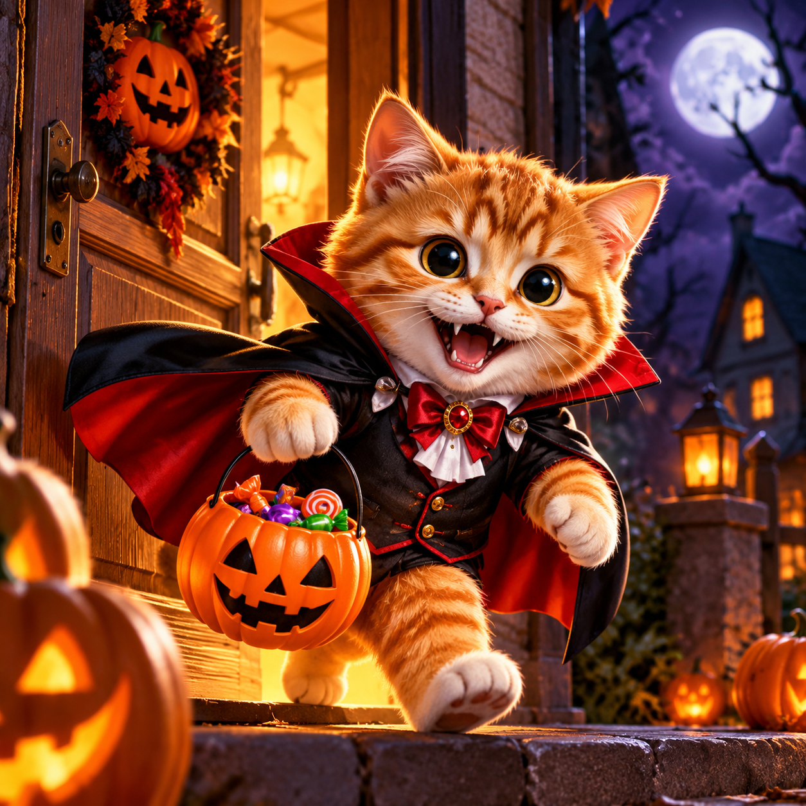
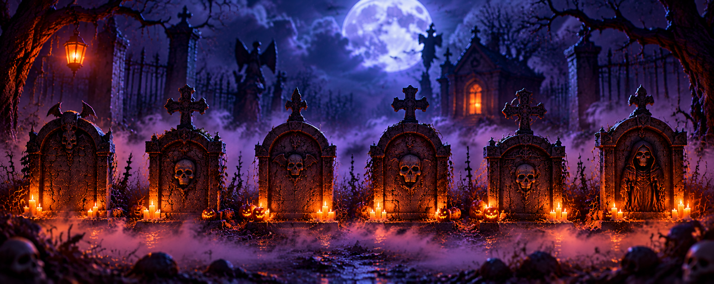

<!DOCTYPE html>
<html lang="es">
<head>
<meta charset="UTF-8">
<meta name="viewport" content="width=device-width, initial-scale=1, viewport-fit=cover">
<meta name="theme-color" content="#08040d">
<title>Tom y el Cementerio Maldito</title>

</head>

<body>

<!-- PORTADA A PANTALLA COMPLETA -->
<section id="intro" class="screen">
  
  

  

    <button class="round" id="sound" aria-label="Activar sonido">🔇</button>
  

  

    <h1>Tom y el Cementerio Maldito</h1>
    
Una noche de Halloween, una aventura aterradora…

    <button class="action" id="start">▶ COMENZAR HISTORIA</button>
  

</section>

<!-- CORTOMETRAJE AUTOMÁTICO -->
<section id="film" class="screen hidden">
  
  

  

  

    <button class="round" id="muteFilm" aria-label="Activar o silenciar sonido">🔇</button>
    <button class="round" id="skip" aria-label="Saltar película">⏭</button>
  

  

    

    

  

</section>

<!-- IMAGEN PANORÁMICA DE LAS SEIS TUMBAS -->
<section id="tombs" class="screen hidden">
  
  

  

    <button class="round" id="muteTombs" aria-label="Sonido">🔊</button>
  

  

    <h2>Las seis tumbas malditas</h2>
    
Tom encontró seis tumbas… elegí una para descubrir tu premio.

  

  <button class="tomb-choice" style="left:3%"
          aria-label="Elegir tumba 1">1</button>
  <button class="tomb-choice" style="left:19%"
          aria-label="Elegir tumba 2">2</button>
  <button class="tomb-choice" style="left:35%"
          aria-label="Elegir tumba 3">3</button>
  <button class="tomb-choice" style="left:51%"
          aria-label="Elegir tumba 4">4</button>
  <button class="tomb-choice" style="left:67%"
          aria-label="Elegir tumba 5">5</button>
  <button class="tomb-choice" style="left:83%"
          aria-label="Elegir tumba 6">6</button>
</section>

<!-- RESULTADO A PANTALLA COMPLETA -->
<section id="result" class="screen hidden">
  
  

    <h2 id="resultTitle">¡La tumba reveló tu premio!</h2>
    

    

    

      🎁 Sin mínimo de carga. 
      💰 Tope de bonificación: $30.000. 
      🔄 Para retirar con bono hay que duplicarlo. 
      🚫 No válido para ruleta. 
      🎮 Una plataforma, una carga y un número. 
      🐱 Una vez por usuario.
    

    <a class="action" id="claim"
       href="https://wa.link/v2txxr"
       target="_blank" rel="noopener">
       💬 RECLAMAR MI PREMIO
    </a>

    
Guardá una captura de tu resultado.

  

</section>

</body>
</html>
